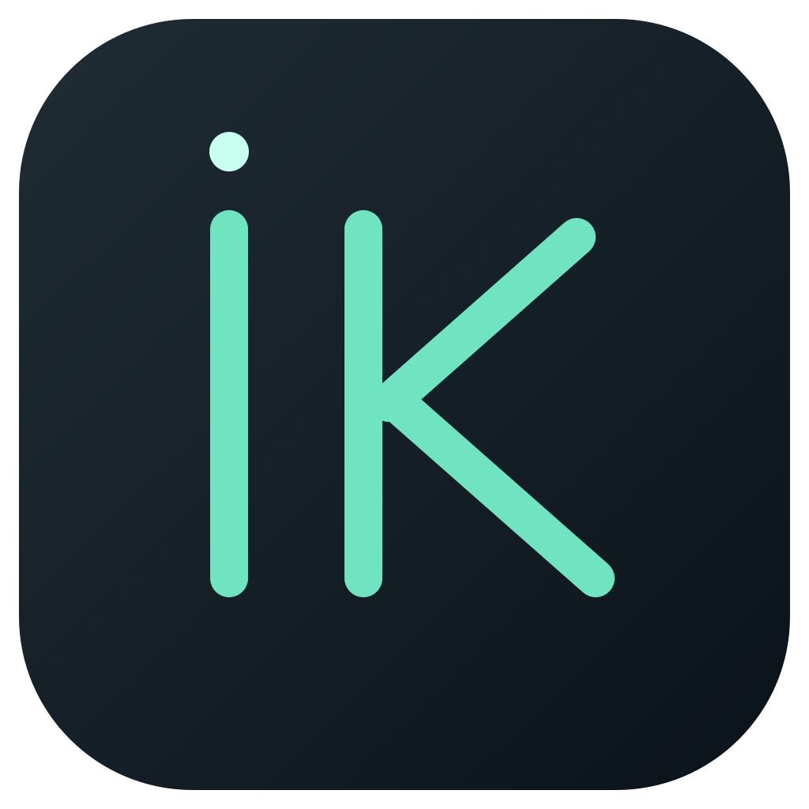
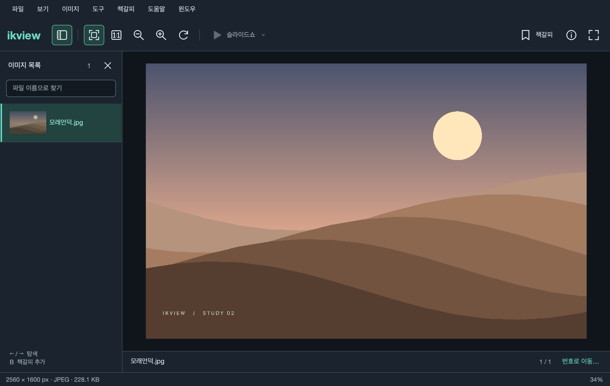
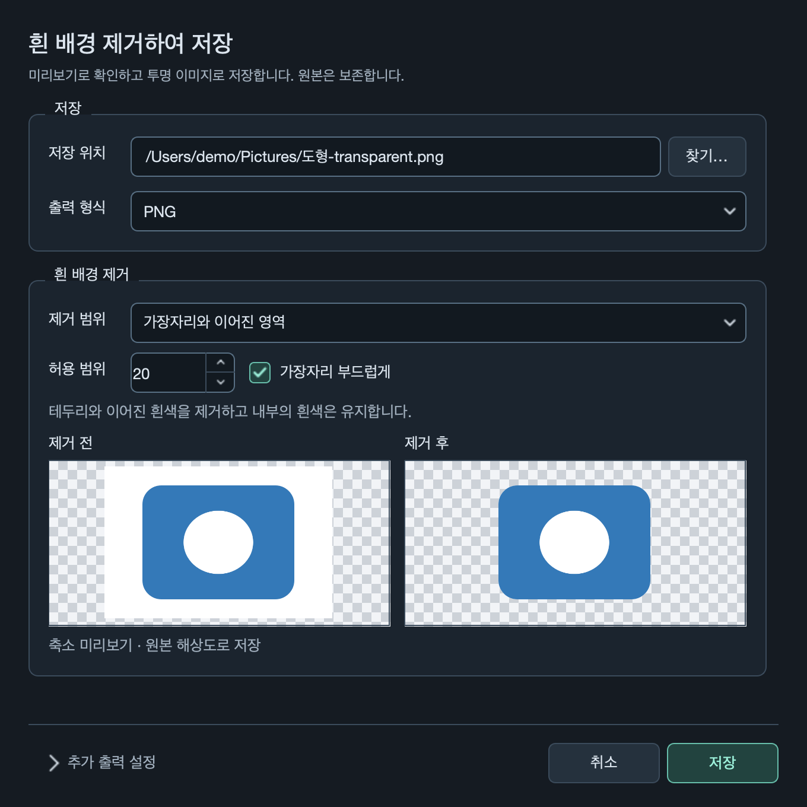

<p align="center">
  
</p>

<h1 align="center">IKView</h1>

<p align="center">
  이미지와 PDF를 빠르게 열고, 편하게 넘기는 macOS 뷰어.
</p>

<p align="center">
  
  
  
</p>

<p align="center">
  <a href="#주요-기능">주요 기능</a> ·
  <a href="#설치">설치</a> ·
  <a href="#빠르게-시작하기">빠르게 시작하기</a> ·
  <a href="#직접-빌드">직접 빌드</a> ·
  <a href="#문서">문서</a>
</p>

<picture>
  <source media="(prefers-color-scheme: dark)" srcset="docs/images/viewer-dark.png">
  <source media="(prefers-color-scheme: light)" srcset="docs/images/viewer-light.png">
  
</picture>

<p align="center"><sub>다크·라이트 테마와 필요한 조작만 남기는 화면 구성</sub></p>

## 주요 기능

| 기능 | 할 수 있는 일 |
| --- | --- |
| **이미지 탐색** | 드래그 앤 드롭, 폴더·여러 파일 열기, 자연스러운 이름 정렬, 검색, 섬네일, 앞뒤 이미지 미리 읽기 |
| **압축파일 열람** | ZIP·CBZ, RAR·CBR, 7z, TAR, LZH 내부 이미지를 별도 압축 해제 없이 보기 |
| **PDF** | 페이지 번호로 이동, 방향키 탐색, 페이지 슬라이드쇼, 선택한 이미지를 원하는 순서로 PDF 묶기 |
| **보기 조절** | 화면·폭·원본 크기 맞춤, 커서 기준 확대, 두 장 보기, 회전·반전, 부드럽게·선명하게 필터 |
| **변환과 배경 처리** | 크기·형식·품질·여백 조절, 투명 여백, 흰 배경 제거, 원본을 보존하는 사본 저장 |
| **작업 환경** | 책갈피, 단축키 변경, 다크·라이트·시스템 테마, 집중 보기, 사양에 맞는 캐시 프리셋 |
| **macOS 연동** | Finder 메뉴, 기본 앱 등록·복원, 터미널에서 파일·폴더 열기 |

JPEG·PNG·GIF·WebP·TIFF·BMP 등 Qt 코덱과 macOS ImageIO가 지원하는 형식을 읽습니다. HEIC·RAW 지원 범위는 macOS와 카메라 모델에 따라 다릅니다. 실제 형식 목록은 앱의 **정보 / 지원 형식**에서 확인할 수 있습니다.

### 흰 배경을 투명하게

이미지에서 우클릭한 뒤 **흰 배경 제거하여 저장…**을 선택하세요. 전후 미리보기와 허용 범위를 조절하고 새 파일로 저장합니다. 가장자리와 이어진 흰색을 제거하는 방식이 기본이며, 이미지 내부의 흰색까지 제거하는 옵션도 제공합니다.

<p align="center">
  
</p>

PNG·WebP·TIFF·PDF 변환은 투명·반투명 여백을 지원합니다. PDF의 투명 여백은 뷰어에서 흰 용지처럼 보일 수 있습니다. 흰 배경 제거는 색상과 연결 영역을 기준으로 하므로 배경과 이어진 흰 피사체도 제거될 수 있습니다.

## 설치

현재 배포 대상은 **Apple Silicon · macOS 26 이상**입니다. 설치 파일은 소스 저장소와 별도로 배포합니다.

1. 배포 파일 `ikview-macos-arm64.zip`의 압축을 풉니다.
2. `ikview.app`을 **응용 프로그램** 폴더로 옮깁니다.
3. 앱을 열고 이미지나 PDF를 끌어놓습니다.

<!-- 공개 스토리지에 설치 파일을 업로드한 뒤 이 위치에 다운로드 링크를 추가합니다. -->

현재 배포본은 로컬 서명을 사용하며 Apple 공증은 적용하지 않았습니다. 다운로드한 앱의 실행이 차단되면 macOS **시스템 설정 → 개인정보 보호 및 보안**에서 차단된 앱을 확인하세요.

## 빠르게 시작하기

- **⌘O**로 이미지·PDF·폴더·압축파일을 선택하거나 창에 끌어놓습니다.
- **← / →**로 넘기고 **1**로 화면에 맞춥니다. PDF에서는 페이지를 이동합니다.
- **⌘T**로 변환창을 엽니다. 여러 이미지를 선택했다면 선택 메뉴가 열립니다.
- **Tab**으로 목록과 도구 모음을 숨기고 이미지에 집중합니다. **Esc**로 돌아옵니다.
- 슬라이드쇼 버튼에서 간격을 고르면 바로 재생합니다.

<details>
<summary><strong>자주 쓰는 기본 단축키</strong></summary>

| 동작 | 단축키 |
| --- | --- |
| 파일·폴더 열기 | ⌘O |
| 이전 / 다음 | ← / → 또는 ⇧Space / Space |
| 화면 맞춤 / 100% / 폭 맞춤 | 1 / 0 / 8 |
| 확대 / 축소 | + / − 또는 트랙패드 핀치 |
| 오른쪽 / 왼쪽 회전 | ⌘R / ⌘L |
| 두 장 보기 / 읽기 방향 | 7 / 6 |
| 목록 검색 | ⌘F |
| 이미지·PDF 페이지 번호로 이동 | ⌘J |
| 책갈피 추가 / 책갈피 목록 | B / F3 |
| 이미지 변환 / 다중 선택 메뉴 | ⌘T |
| 이미지 목록 / 이미지 정보 | ⌘⇧L / ⌘I |
| 집중 보기 / 복귀 | 이미지 영역에서 Tab / Esc |
| 기본 화면으로 복원 | ⌘⇧R |
| 환경설정 | ⌘, |

단축키는 **환경설정 → 단축키**에서 변경할 수 있습니다. 전체 목록은 앱의 **키보드 사용법**에서 확인하세요.

</details>

### Finder와 터미널에서 열기

빌드·설치한 앱에 연동 도구를 등록하면 Finder에서 **IKView로 열기 / IKView로 폴더 열기**를 사용할 수 있습니다.

```sh
./scripts/install-macos-integration.sh
export PATH="$HOME/.local/bin:$PATH"

ikview .
ikview ~/Pictures
ikview --finder-status
ikview --finder-enable
```

Finder 확장의 실제 활성화는 macOS 설정과 앱 서명 상태에 따라 달라집니다. 기본 앱 변경은 형식별로 선택하고 이전 설정으로 복원할 수 있습니다. [macOS 연동 안내](docs/macos-integration.md)에 설치 경로와 명령을 정리했습니다.

## 직접 빌드

C++20, CMake 3.24 이상, Qt 6.7 이상, libarchive가 필요합니다. Exiv2를 설치하면 EXIF 정보 처리를 함께 빌드합니다. 현재 검증 환경은 Apple Silicon과 Qt 6.12입니다.

```sh
git clone https://github.com/ImuruKevol/ikview.git
cd ikview

xcode-select --install
brew install cmake qtbase qtdeclarative qtimageformats qtsvg libarchive exiv2

./scripts/build-macos.sh
./scripts/package-macos.sh --skip-gui-smoke
```

| 생성 파일 | 용도 |
| --- | --- |
| `build/ikview.app` | 개발용 실행 앱 |
| `dist/ikview.app` | 라이브러리를 포함한 배포용 앱 |
| `dist/ikview-macos-arm64.zip` | 스토리지에 올릴 설치 압축파일 |
| `dist/ikview-package-validation.json` | 버전·서명 검사·파일 해시 기록 |

기본 빌드는 실제 데스크톱 창을 띄우는 검사를 제외합니다. 위 패키징 명령도 앱 실행 검사를 생략하고 검증 기록에 남깁니다. 전체 검사와 배포 절차는 [빌드 안내](docs/building.md)를 참고하세요.

## 성능을 위한 구조

C++20과 Qt Widgets로 UI를 구성하고, 이미지 표시는 Qt Quick의 Metal 장면 그래프로 처리합니다. 스캔·디코딩·변환은 UI와 분리된 작업 스레드에서 수행합니다.

- 앞뒤 이미지 미리 읽기와 픽셀 비용을 기준으로 관리하는 LRU 캐시
- 현재 화면에 필요한 섬네일과 큰 이미지의 가시 영역만 준비
- 확대·이동·회전을 변환 행렬로 처리하여 불필요한 이미지 재생성 줄이기
- 새 요청이 들어오면 이전 요청의 취소 또는 결과 반영 차단
- 배경 제거 미리보기의 해상도와 동시 계산 수 제한

캐시 설정은 앱 전체 메모리 사용량의 상한이 아닙니다. 원본 이미지, 디코딩 중 데이터, GPU 텍스처는 별도 메모리를 사용합니다. [구조와 제한](docs/architecture.md)에서 자세히 설명합니다.

## 문서

| 문서 | 내용 |
| --- | --- |
| [사용 안내](docs/usage.md) | 탐색, 필터, 책갈피, PDF, 변환, 배경 제거 |
| [macOS 연동](docs/macos-integration.md) | Finder 확장, 터미널 명령, 기본 앱 등록·복원 |
| [빌드 안내](docs/building.md) | 개발 환경, 창을 띄우지 않는 검사, 배포 파일 생성 |
| [구조와 제한](docs/architecture.md) | 렌더링·캐시 설계, 지원 범위, 주요 코드 위치 |
| [기여 안내](CONTRIBUTING.md) | 문제 제보와 변경 제안 |

## 기여와 라이선스

문제나 개선 제안은 [이슈](https://github.com/ImuruKevol/ikview/issues)로 남겨 주세요. 재현 절차와 사용 환경을 함께 적어 주시면 확인에 도움이 됩니다.

프로젝트 자체의 소스 라이선스는 아직 지정되지 않았습니다. 사용 라이브러리와 배포 고지는 [외부 라이브러리 안내](THIRD_PARTY.md)에 정리했습니다. 배포 앱에도 각 라이브러리의 라이선스 문서를 포함합니다.
